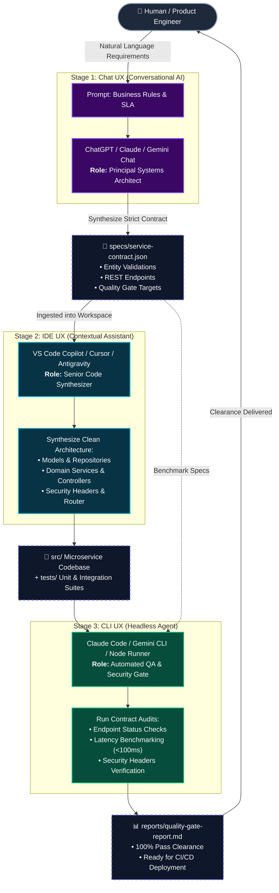
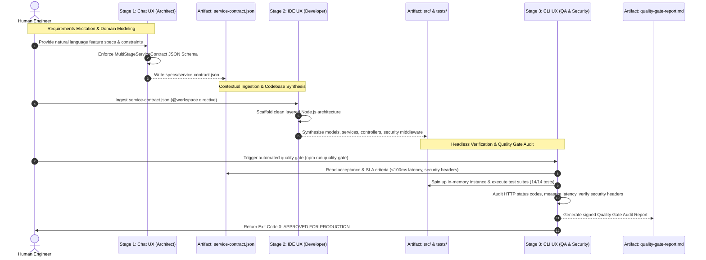
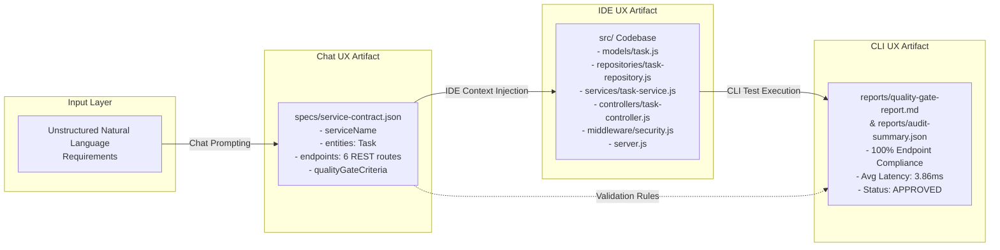

# Multi-Stage AI Workflow Diagrams

This document contains visual diagrams illustrating the multi-stage AI workflow across Chat, IDE, and CLI UX types.

---

## 1. End-to-End Architecture Flowchart

---

## 2. Sequence Diagram (Cross-UX Chaining Protocol)

---

## 3. Data Flow & Handoff Schema

